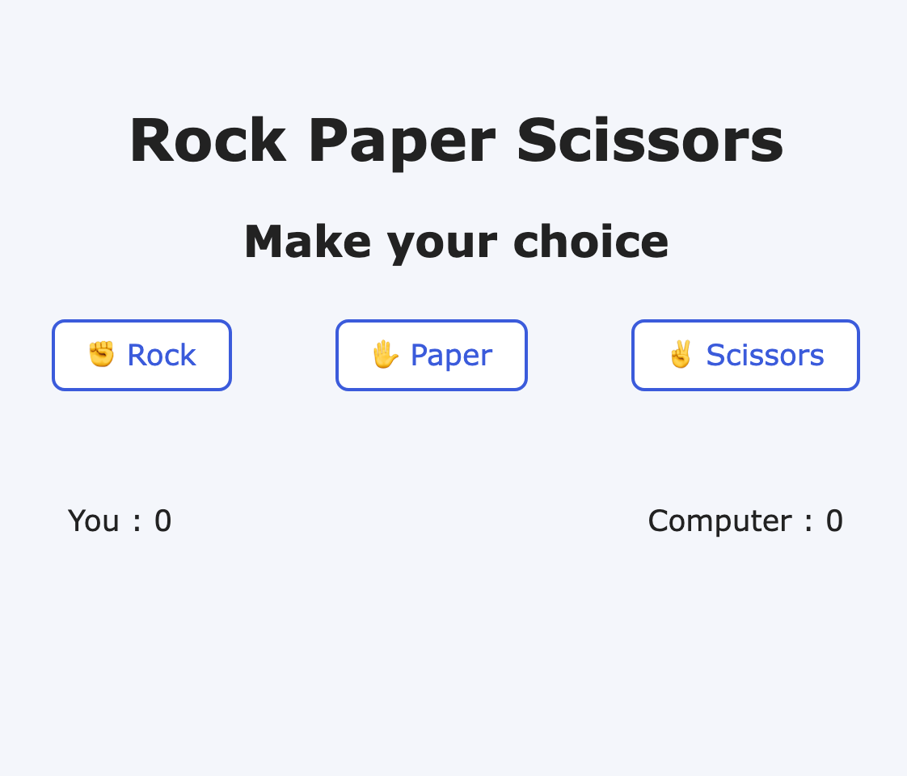

# Rock Paper Scissors

A rock-paper-scissors game against the computer, written in pure JavaScript.

🔗 **[Online demo](https://ikab08.github.io/rock-paper-scissor/)**

## Features
- 5-round game against the computer
- Live score display
- End-of-game message and “Play Again” button

## Technologies
HTML, CSS, JavaScript

## Run locally
Clone the repository, then open `index.html` in your browser.